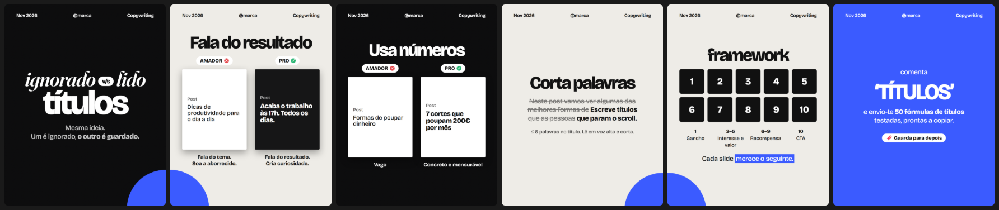
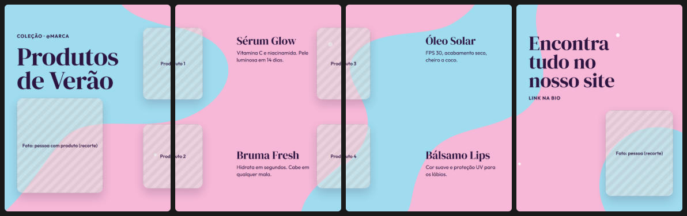
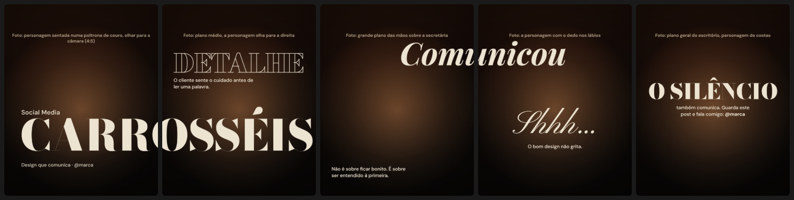
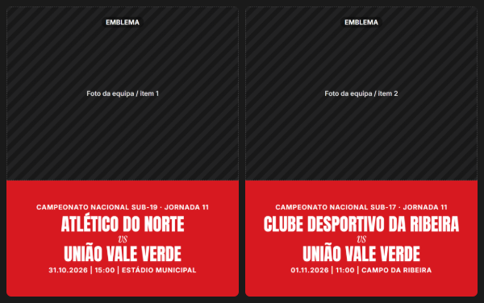

# Carrosséis para Instagram: skills para o Claude

Duas skills para o [Claude Code](https://claude.com/claude-code) (e para o Claude em claude.ai) que criam carrosséis de Instagram completos: roteiro, legenda, hashtags e os slides prontos a publicar, **em PNG ou como vídeo MP4 animado**.

| Skill | Comando | Entrega |
|---|---|---|
| `carrosseis-instagram` | `/carrosseis-instagram` ou "faz-me um carrossel sobre…" | Roteiro + legenda + slides PNG 1080×1350 |
| `carrossel-mp4` | `/carrossel-mp4` | O mesmo carrossel como **MP4 animado** estilo After Effects, com som |

## Exemplos (gerados pela skill)

**Educativo / listicle**: comparações, framework, CTA, com um disco de cor que liga os slides 1→2 e 4→5


**Fundo contínuo**: as manchas atravessam todos os slides e os produtos ficam em cima das divisões


**Cinematográfico**: uma palavra gigante por slide em fontes expressivas; "CARROS|SÉIS" e "Comuni|cou" atravessam a divisão


**Template em série**: o mesmo layout, dados diferentes, com o título ajustado para ficar igual em todos os slides


> As zonas com riscas são placeholders onde entram as tuas fotos. A skill não gera imagens.

## O que a skill sabe fazer

- **5 arquétipos**: educativo/listicle · portefólio/photo dump · contínuo/panorâmico (incluindo fundo contínuo) · template em série · cinematográfico.
- **Continuidade entre slides** obrigatória: o slide 2 mostra o fim de algo que começou no slide 1 (título partido, objeto na divisão, fundo contínuo, corte de cena).
- **Sem "desliza →"/NEXT repetido**: a continuidade faz esse papel.
- **16 pares de fontes** do Google Fonts por tom, com histórico, para não repetir as mesmas fontes.
- **14 paletas "2 base + 1 pop"**: duas cores fazem o trabalho e uma terceira destaca-se em ≤ 10% do design (ex.: *charcoal black + royal blue + tangerine*), com o contraste medido.
- **Revisão de design baseada nas Apple Human Interface Guidelines**:
  - tamanhos mínimos convertidos para o feed (1pt ≈ 2,77px → texto ≥ 31px);
  - contraste 4.5:1 / 3:1;
  - os 8 princípios da Apple usados como filtro;
  - "remove um acessório" no fim.
- **Copy**: fórmulas de gancho, CTA com recompensa, legenda com keywords.
- **Imagens**: tuas fotos, bancos livres (Unsplash/Pexels/Pixabay, sempre com autorização antes de descarregar) ou prompts prontos para IA. Nunca imagens de portefólios de terceiros.

### `/carrossel-mp4`
- Animação automática estilo After Effects:
  - títulos letra a letra ou com "wipe";
  - texto em cascata e autocolantes com ressalto;
  - Ken Burns nas fotos;
  - movimento de câmara com desfoque entre slides.
- Afinação opcional com `data-anim` / `data-delay`.
- Feed 4:5 (1080×1350) ou Reels 9:16 (`--reels`).
- **Som que não se repete**: 5 variantes de whoosh, 3 de pop e 3 de impacto, geradas por síntese (sem direitos). Cada disparo tem tom, duração e pan estéreo ligeiramente diferentes, e a mesma variante nunca toca duas vezes seguidas.
- **Openverse**: pesquisa de sons e música **CC0 / domínio público** (sem crédito obrigatório). Podes usar vários ficheiros por tipo, que rodam sem repetir.
- **Sem ffmpeg**: o vídeo é renderizado pelo Chrome (GSAP + WebCodecs) e sai em H.264 + AAC, com o `moov` no início do ficheiro.

## Instalação

### Claude Code
```bash
git clone https://github.com/Yupzao/carrosseis-instagram-skill.git
cp -r carrosseis-instagram-skill/skills/* ~/.claude/skills/
```
No Windows (PowerShell):
```powershell
git clone https://github.com/Yupzao/carrosseis-instagram-skill.git
Copy-Item -Recurse carrosseis-instagram-skill\skills\* $HOME\.claude\skills\
```
Depois, numa sessão nova, pede um carrossel ou escreve `/carrosseis-instagram` ou `/carrossel-mp4`.

### claude.ai
Comprime cada pasta de `skills/` num zip (a pasta tem de ficar na raiz do zip) e carrega-o em **Settings → Capabilities → Skills**.
O render para PNG/MP4 precisa de Chrome local, por isso funciona melhor no Claude Code.

### Requisitos
- **Node.js ≥ 22** (usa o `fetch` e o `WebSocket` nativos)
- **Google Chrome** ou **Microsoft Edge** (deteta automaticamente; ou define `CHROME_PATH`)
- Ligação à internet para Google Fonts, GSAP (cdnjs), mp4-muxer (jsDelivr) e Openverse

## Estrutura
```
skills/
├── carrosseis-instagram/
│   ├── SKILL.md                  # fluxo e regras de ouro
│   ├── references/               # arquétipos, continuidade, fontes, cores, copy, design, imagens, vídeo, apple-design
│   ├── assets/kit/               # base.css + carousel.js (sistema de slides 1080×1350)
│   ├── assets/exemplos/          # 6 templates de partida
│   └── scripts/
│       ├── render.mjs            # HTML → PNG por slide (Chrome headless)
│       ├── video.mjs             # HTML → MP4 animado com som
│       ├── video/animate.js      # coreografia GSAP
│       ├── video/encoder.html    # WebCodecs: H.264 + AAC, síntese dos efeitos sonoros
│       ├── sons.mjs              # pesquisa/descarrega sons CC0 do Openverse
│       └── contrast.mjs          # rácio de contraste WCAG
└── carrossel-mp4/
    └── SKILL.md                  # usa a skill acima e entrega MP4
```

## Uso direto dos scripts
```bash
node skills/carrosseis-instagram/scripts/render.mjs carrossel.html png/
node skills/carrosseis-instagram/scripts/video.mjs carrossel.html video.mp4 --reels --seed=7
node skills/carrosseis-instagram/scripts/sons.mjs procurar "whoosh" --tipo=sfx
node skills/carrosseis-instagram/scripts/contrast.mjs "#FFFFFF" "#2F4BDB" 46
```

---
🤖 Criado com [Claude Code](https://claude.com/claude-code)
