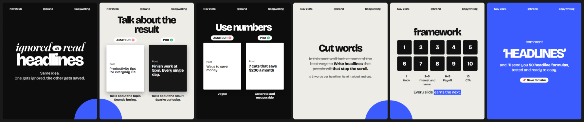
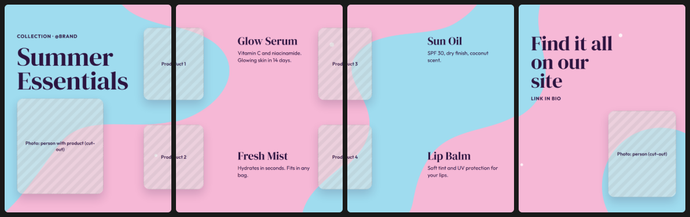
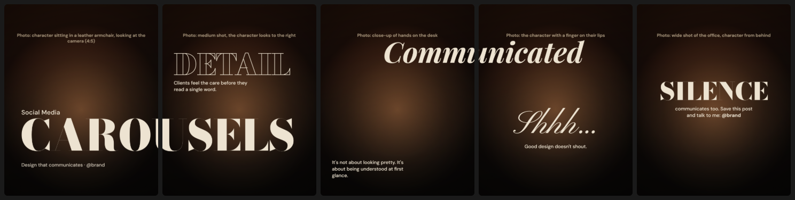
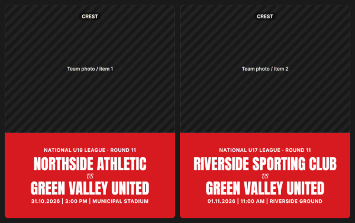

# Instagram carousels: skills for Claude

Two skills for [Claude Code](https://claude.com/claude-code) (and for Claude on claude.ai) that create complete Instagram carousels: script, caption, hashtags and the ready-to-post slides, **as PNGs or as an animated MP4 video**.

| Skill | Command | Output |
|---|---|---|
| `instagram-carousel` | `/instagram-carousel` or "make me a carousel about…" | Script + caption + 1080×1350 PNG slides |
| `carousel-mp4` | `/carousel-mp4` | The same carousel as an After Effects-style **animated MP4**, with sound |

## Examples (rendered by the skill)

**Educational / listicle**: comparisons, framework, CTA, with a pop-colour disc linking slides 1→2 and 4→5


**Continuous background**: the blobs run across every slide and the products sit on top of the seams


**Cinematic**: one giant word per slide in expressive fonts; "CAROU|SELS" and "Communi|cated" cross the seam


**Series template**: same layout, different data, with the title fitted to the same size on every slide


> The striped areas are placeholders for your photos. The skill does not generate images.

## What the skill does

- **5 archetypes**: educational/listicle · portfolio/photo dump · continuous/panoramic (including continuous backgrounds) · series template · cinematic.
- **Mandatory continuity between slides**: slide 2 shows the end of something that started on slide 1 (split title, object on the seam, continuous background, scene cut).
- **No repeated "swipe →"/NEXT**: continuity does that job.
- **16 Google Fonts pairings** by mood, with a history log so the same fonts don't repeat.
- **14 "2 base + 1 pop" palettes**: two colours do the work and a third one stands out in ≤ 10% of the design (e.g. *charcoal black + royal blue + tangerine*), with measured contrast.
- **Design review based on Apple's Human Interface Guidelines**:
  - minimum sizes converted to the feed (1pt ≈ 2.77px → text ≥ 31px);
  - 4.5:1 / 3:1 contrast;
  - Apple's 8 principles used as a filter;
  - "remove one accessory" at the end.
- **Copy**: hook formulas, CTA with a reward, caption with keywords. Copy is written in the user's language.
- **Images**: your photos, free stock libraries (Unsplash/Pexels/Pixabay, always with permission before downloading) or ready-made AI prompts. Never images from other people's portfolios.

### `/carousel-mp4`
- Automatic After Effects-style animation:
  - titles letter by letter or with a wipe;
  - staggered text and stickers that pop in with overshoot;
  - Ken Burns on photos.
- **Reel-style edit**, modelled on fast-cut motion-design reels:
  - stutter-zoom intro on the cover (visible from frame 0);
  - transitions varied between hard cut (flash + punch-in + shake), whip pan, zoom-through and pan, keeping pan/whip wherever continuity crosses a seam;
  - a riser that ends exactly on the final reveal;
  - optional beat grid (`--bpm` / `--beat`) so every cut lands on the beat.
- 4:5 feed (1080×1350) or 9:16 Reels (`--reels`) with a **blurred background fill** and an optional **title band** (`--header="Small|Big"`).
- Optional fine-tuning with `data-anim` / `data-delay` / `data-transition`.
- **Sound design**: an impact on every cut, stutter thuds, UI ticks, keystrokes for typed titles, whooshes, risers and a final shimmer, all synthesised (no rights). They go through a compressor → limiter bus with reverb, and the music or a built-in beat bed ducks under the hits. Each trigger varies in pitch, length and stereo pan, and the same variant never plays twice in a row.
- **Higgsfield API** (optional, with your own key): generate the photos and short image-to-video clips with `scripts/higgsfield.mjs`.
- **Openverse**: search for **CC0 / public domain** sounds and music (no credit required). You can use several files per type, which rotate without repeats.
- **No ffmpeg**: the video is rendered by Chrome (GSAP + WebCodecs) as H.264 + AAC, with the `moov` atom at the start of the file.

## Installation

### Claude Code
```bash
git clone https://github.com/Yupzao/instagram-carousel-skill.git
cp -r instagram-carousel-skill/skills/* ~/.claude/skills/
```
On Windows (PowerShell):
```powershell
git clone https://github.com/Yupzao/instagram-carousel-skill.git
Copy-Item -Recurse instagram-carousel-skill\skills\* $HOME\.claude\skills\
```
Then, in a new session, ask for a carousel or type `/instagram-carousel` or `/carousel-mp4`.

### claude.ai
Zip each folder in `skills/` (the folder must sit at the root of the zip) and upload it in **Settings → Capabilities → Skills**.
Rendering to PNG/MP4 needs a local Chrome, so it works best in Claude Code.

### Requirements
- **Node.js ≥ 22** (uses the native `fetch` and `WebSocket`)
- **Google Chrome** or **Microsoft Edge** (detected automatically; or set `CHROME_PATH`)
- Internet access for Google Fonts, GSAP (cdnjs), mp4-muxer (jsDelivr) and Openverse
- Optional: a Higgsfield API key in `HIGGSFIELD_KEY` (`<key-id>:<key-secret>`) for AI images/clips

## Structure
```
skills/
├── instagram-carousel/
│   ├── SKILL.md                  # workflow and golden rules
│   ├── references/               # archetypes, continuity, fonts, colors, copy, design, images, video, apple-design
│   ├── assets/kit/               # base.css + carousel.js (1080×1350 slide system)
│   ├── assets/examples/          # 6 starter templates
│   └── scripts/
│       ├── render.mjs            # HTML → one PNG per slide (headless Chrome)
│       ├── video.mjs             # HTML → animated MP4 with sound
│       ├── video/animate.js      # GSAP choreography
│       ├── video/encoder.html    # WebCodecs: H.264 + AAC, synthesised sound effects
│       ├── sounds.mjs            # search/download CC0 sounds from Openverse
│       ├── higgsfield.mjs        # Higgsfield API: AI images and image-to-video (your key)
│       └── contrast.mjs          # WCAG contrast ratio
└── carousel-mp4/
    └── SKILL.md                  # uses the skill above and delivers an MP4
```

## Using the scripts directly
```bash
node skills/instagram-carousel/scripts/render.mjs carousel.html png/
node skills/instagram-carousel/scripts/video.mjs carousel.html video.mp4 --reels --header="Social Media|Design that communicates" --beat=118
node skills/instagram-carousel/scripts/sounds.mjs search "whoosh" --type=sfx
node skills/instagram-carousel/scripts/contrast.mjs "#FFFFFF" "#2F4BDB" 46
```

## License
[MIT](LICENSE): free to use, modify and distribute, keeping the copyright notice.

External resources loaded at runtime keep their own licences: Google Fonts (OFL), GSAP (GreenSock standard licence), mp4-muxer (MIT) and Openverse sounds (CC0 / public domain only).

---
🤖 Built with [Claude Code](https://claude.com/claude-code)
